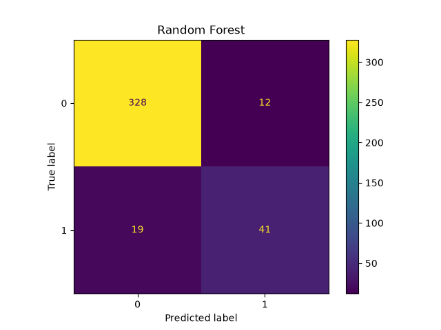
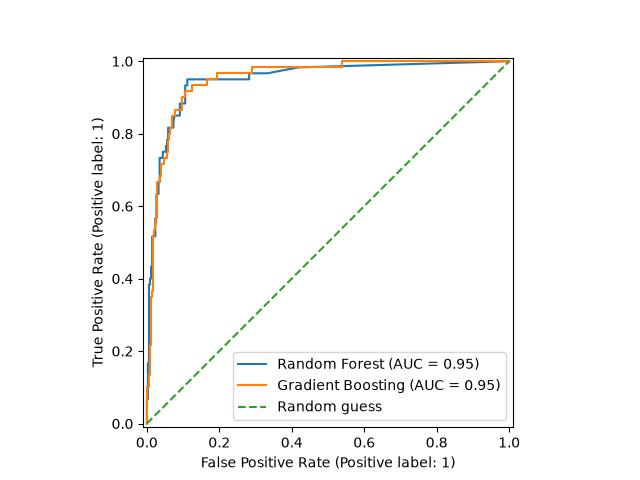

# Лабораторна робота №4. Класичні алгоритми машинного навчання та регресійний/класифікаційний аналіз інженерних даних на мові Python 
Прогнозування утечок пам'яті (OOM) у Kubernetes сервісах (Варіант 4)
• Вхідні ознаки X: Вхідні ознаки X: [RSS_RAM_MB, Heap_Alloc, GC_Pause_ms, ActiveThreads, FileDescriptors].
• Алгоритми для порівняння: Random Forest vs Gradient Boosting (XGBoost).
• Цільова змінна Y: Цільова змінна Y: 0 — Safe, 1 — OOM Risk у наступні 10 хв [Класифікація].
• Інженерна мета: Превентивно виявляти ризик падіння контейнера.

# Данні:
Синтетичний набір даних: 2000 рядків, згенерованих за допомогою generate_data.py. 
Мітки класів визначаються на основі формули оцінювання ризику з додаванням шуму, причому до класу OOM віднесено 15% записів із найвищими оцінками ризику.

Частка позитивного класу становить 15%, тому класи є незбалансованими.

Розподіл даних: 80/20 зі стратифікацією та random_state=42 (1600 записів для навчання, 400 для тестування).

StandardScaler навчено лише на тренувальній вибірці. Категоріальних ознак немає, тому кодування не потрібне.

# Методика

Моделі та параметри:

Random Forest: n_estimators=100, max_depth=12.

Gradient Boosting: n_estimators=100, learning_rate=0.1, max_depth=5.

Метрики оцінювання: точність (Accuracy), прецизійність (Precision), повнота (Recall), F1-міра, ROC-AUC, а також час виконання (навчання та прогнозування, у мс) і пікове використання пам’яті (у КБ, виміряне за допомогою tracemalloc).

# Таблиця результатів

| name              |   exec_time |   peak_mem |   accuracy_score |   precision_score |   recall_score |   f1_score |   roc_auc_score |
|:------------------|------------:|-----------:|-----------------:|------------------:|---------------:|-----------:|----------------:|
| Random Forest     |     534.396 |    332.793 |           0.9225 |          0.773585 |       0.683333 |   0.725664 |        0.950196 |
| Gradient Boosting |     458.692 |    248.369 |           0.9225 |          0.763636 |       0.7      |   0.730435 |        0.952353 |

# Графіки

Матриця помилок для Random Forest: 328 правильно визначених безпечних випадків, 12 хибних тривог, 19 пропущених випадків OOM і 41 правильно виявлений випадок OOM.

Матриця помилок для Gradient Boosting: 327 правильно визначених безпечних випадків, 13 хибних тривог, 18 пропущених випадків OOM і 42 правильно виявлені випадки OOM.

ROC-криві перетинаються: Random Forest має дещо кращі результати за FPR близько 0,1, тоді як Gradient Boosting демонструє кращі результати за вищих значень FPR. Значення ROC-AUC майже однакові.

# Аналіз результатів

Загальна ефективність. Обидві моделі демонструють майже однакові результати. Значення Accuracy однакове й становить 0,9225. 
Водночас Gradient Boosting виявив на один випадок OOM більше, ніж Random Forest, але також спричинив на одну хибну тривогу більше.

Обмеженість Accuracy. У цьому випадку Accuracy може вводити в оману, оскільки модель, яка завжди прогнозує безпечний стан, також досягла б точності 0,85. 
Тому важливішими метриками є Recall і F1-міра. Пропущений ООМ більш важливий в порівнянні з хибною тривогою.

Обчислювальні витрати. У цьому експерименті Gradient Boosting працював швидше та використовував менше пам’яті, ніж Random Forest. 
Час виконання становив 451,8 мс проти 529,5 мс, а пікове використання пам’яті — 245,3 КБ проти 332,3 КБ відповідно.

Обмеження експерименту. Тестова вибірка містить лише 60 позитивних прикладів, тому навіть невелика кількість помилок може помітно вплинути на результати. 
Виявлені відмінності можуть бути випадковими, а зміна розподілу даних на тренувальну й тестову вибірки може змінити рейтинг моделей. 
Крім того, дані є синтетичними, тому отримані результати не обов’язково відображатимуть поведінку реальних сервісів Kubernetes.

Вибір порога класифікації. За стандартного порога 0,5 повнота обох моделей становить приблизно 0,7. 
Оскільки пропущені випадки OOM можуть мати серйозніші наслідки, ніж хибні тривоги, доцільно знизити поріг класифікації.
 Це дозволить виявляти більше потенційно небезпечних ситуацій, хоча й збільшить кількість хибних спрацювань. 
 Значення ROC-AUC близько 0,95 свідчить про хорошу здатність моделей розрізняти класи та вказує на можливість підібрати поріг, який краще відповідатиме вимогам системи моніторингу.

Висновок. Для подальшого використання доцільно обрати Gradient Boosting, оскільки він забезпечує таку саму точність, дещо вищі Recall і F1-міру, а також менший час виконання та нижче використання пам’яті. 
Однак ці переваги не можна вважати остаточно доведеними через невеликий розмір тестової вибірки та синтетичний характер даних. 